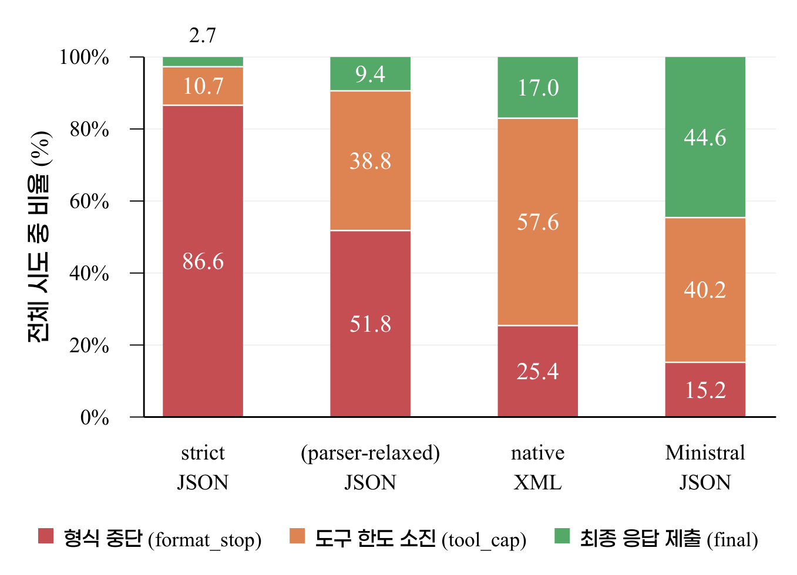

# Failure Analysis of Tool Use in 8B LLMs

[한국어](README.md) · [Paper PDF](CISC-W_2026_paper__196.pdf) · [Code guide](docs/code-guide.md) · [Methods and limitations](docs/methodology.md)

This research separates local 8B LLM tool-use failures into **format compliance, action selection, and execution termination**. A final failure rate can combine several different problems; identifying the observed failure point helps determine what to inspect next.

The repository presents research conducted by the author: experiment execution, failure analysis, diagnostic comparisons, and interpretation. It does not assert sole authorship of every source function or production semiconductor/customer-support experience.

## Main observations

- **When2Call:** 40 items × 8 attempts per condition. Format compliance was 96.3–99.1%, while action accuracy was 41.3–65.0%.
- **Loc-Bench Security:** a common 28-item subset × 8 attempts, or 224 attempts per condition.
- In Granite JSON, the parser-relaxed diagnostic condition had fewer format stops: 194/224 → 116/224, a **34.8 percentage-point decrease**.
- Tool-budget exhaustion increased from 24/224 to 87/224. Final-answer submissions increased from 6/224 to 21/224, while correct function locations increased from 4/224 to 17/224.

The green segment denotes final-answer submission, not correctness. Function accuracy requires a matching code-location path and function name and uses all 224 assigned attempts as the denominator.

## Suggested reading order

1. [Paper](CISC-W_2026_paper__196.pdf): research questions, reported tables, and limitations.
2. [Code guide](docs/code-guide.md): HTTP requests, parsing, loop state, termination, scoring, and result storage.
3. [Public results](results/paper_results.json): paper-table counts in a compact machine-readable form.
4. [Provenance](docs/provenance.md): unchanged archived source files versus publication-time projections and documentation.

## Offline publication check

Python 3.10+ and the standard library are sufficient.

~~~bash
python3 -B scripts/verify_public_results.py
~~~

This checks table arithmetic, agreement with aggregate projections, and hashes of the published paper and archived source/figure files. It also parses archived Python files for syntax without importing or running them. The checker was added for this public repository; it is not a historical experiment test or an inference rerun.

## Interpretation boundaries

The diagnostic was post-hoc. The archived repair function includes trailing-comma removal as well as the numeric stray-quote repair described in the paper; the exact historical code-to-run relationship remains unresolved. Native XML changes both notation and the prompted tool list. Aggregate differences do not establish per-attempt transitions. Tool-budget exhaustion alone does not distinguish insufficient exploration budget from termination decisions.

Models, raw outputs, gold answers, benchmark question payloads, and cloned target repositories are not redistributed. Some intermediate outputs and observations were not retained. See [reproduction prerequisites](docs/reproducibility.md) and [upstream resources](THIRD_PARTY_NOTICES.md).
